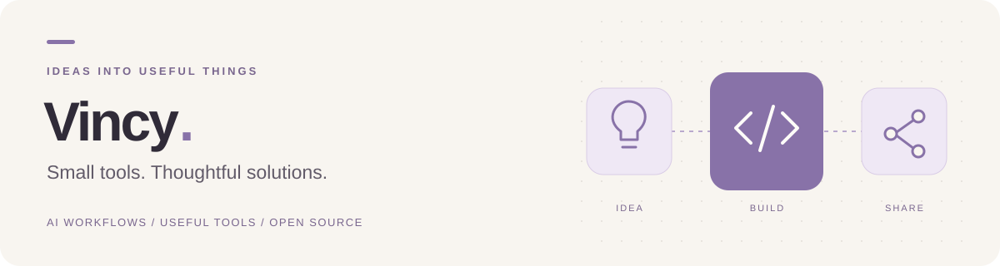

  

<h1 align="center">Hi, I'm Vincy 👋</h1>

  <strong>把工作里的小麻烦，做成好用的小工具。</strong> 
  Building useful tools & exploring AI workflows.

  <a href="https://github.com/SelinaZY?tab=repositories">浏览仓库 · Repositories</a>

---

### 🌱 正在探索

我关注 AI 如何融入日常工作，也准备把解决实际问题的小软件陆续开源。

- **AI 工作流** — 探索从想法到成果更顺手的工作方式。
- **实用小工具** — 从具体的小问题出发，让重复操作更简单。
- **开源实践** — 把工具、使用说明和迭代过程一起分享出来。

### 🛠 作品计划

正在筹备开源小工具。发布后，这里会放上项目截图、使用方法和体验入口。

希望每个作品都能回答一个简单的问题：**它能帮你省下哪一步？**

### 💬 一起交流

欢迎关注，看看下一个小工具会解决什么问题。项目开放后，也欢迎通过对应仓库的 Issues 提建议、反馈问题。

从一个真实问题出发，做一点有用的东西。

